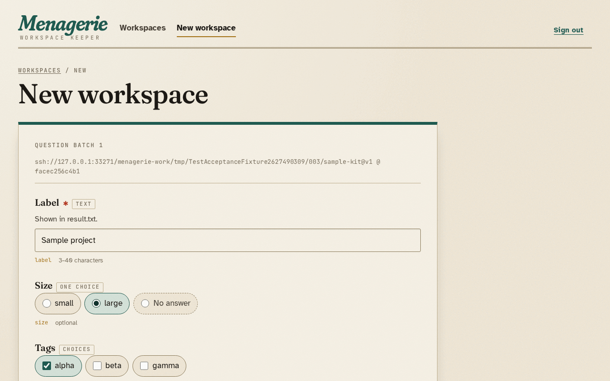

Sign in at Menagerie's address with your identity provider. Members of
`menagerie_managers` see the workspace list; anyone else sees a page that
says they are not a manager, and can change nothing.

## The workspace list

Every folder in the workspace root is a row, with its container's state:
**Running**, **Stopped**, or **No container** for a folder whose
devcontainer was never created. Containers that belong to no folder in the
root do not appear. **Refresh** reads the folders and containers again.

Each row has **Stop**, **Start**, **Rebuild** and **Upgrade**. Rebuild asks
for confirmation, then removes the container and creates it again from the
workspace's definition. While a job runs on a workspace, its row is busy and
its actions wait: a workspace runs one job at a time. Other workspaces stay
usable.

**Jobs since Menagerie started** lists every job and its outcome. Open one to
see its console. Jobs live in memory, so the list starts empty after a
restart.

## Create a workspace

Choose **New workspace**, pick a template and enter the workspace's name,
which becomes its folder. **Begin interview** asks the template's questions.
Answers that the template refuses come back marked on their questions, with
your answers kept, so you can correct them and send again. Nothing is
written until the interview is complete.

The job console then shows each phase:

1. `initialize-repository`: the folder becomes a Git repository.
2. `generate`: Toha writes the files and runs the template's hooks, inside
   the Menagerie container.
3. `commit` and `backup`: the first commit, pushed to the workspace's own
   orphan branch in the workspace repository.
4. `initialize-command`: the devcontainer's `initializeCommand`, inside the
   Menagerie container, in the workspace folder.
5. `build` when the definition builds an image, then `up`: the devcontainer
   starts.

The answers are kept in the workspace, in `.toha.json`.

## Upgrade a workspace

**Upgrade** offers the approved templates. Pick the newer version and choose
**Begin upgrade**. Menagerie first commits any local changes and backs the
workspace up, so the state before the upgrade is on its branch. Then it asks
only the questions the new version adds; earlier answers come from
`.toha.json`. Toha merges the new version into the files, keeping your
edits, and Menagerie commits, backs up and rebuilds the devcontainer.

When the new version and a local edit change the same lines, the upgrade
writes conflict markers, commits and backs them up, and stops before the
rebuild with `merge-conflicted`. Resolve the conflicts in the workspace,
then choose **Rebuild**.

## Backups

Each workspace is backed up to a branch named after its folder, created
without a parent and replaced by force at every backup. To restore a
workspace, clone its branch into a folder in the workspace root by hand;
Menagerie lists it like any other folder.

## Stop, start and rebuild

Start runs `initializeCommand` before it starts the container, as rebuild
does. When `initializeCommand` fails, the job fails with
`initialize-command-failed` and the container stays stopped.
