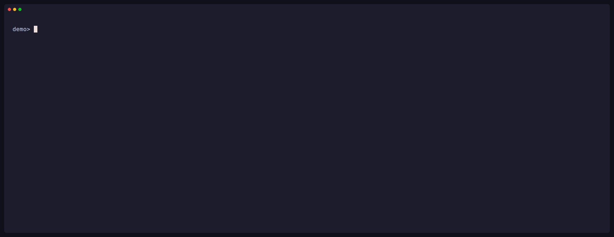

Xolotl is a self-hosted proxy for LLM subscriptions, AI gateway providers and
MCP servers. Your coding agents get one URL and one client key. The real
credentials stay in OpenBao, not in the agents' containers.



## What it does

- **Subscription proxy.** Log in Codex (ChatGPT), Claude and Grok Build
  subscription accounts, and add OpenCode Go API keys. Xolotl keeps the OAuth
  tokens fresh, spreads requests over several accounts, and moves to the next
  account when one reaches its quota.
- **AI gateway.** Send requests to Vercel AI Gateway, Mistral and
  OpenAI-compatible servers such as llama.cpp with keys that xolotl injects.
- **One model namespace.** Clients send a model name. A policy decides which
  provider serves it. Xolotl translates between the Anthropic Messages, OpenAI
  Responses and Chat Completions formats, so Claude Code can use a Codex model
  and Codex CLI can use an Anthropic model on Vercel.
- **MCP gateway.** One MCP server at `/mcp` gives agents code-mode access
  (`search` and `execute`) to the upstream MCP servers their policy allows.
  Upstream credentials and OAuth logins stay in OpenBao.
- **Client keys and policies.** Each client gets its own key. Its policy sets
  the providers, models, model names and MCP tools it can use, and its request
  and token limits. Keys are issued into OpenBao and never printed.
- **Usage and telemetry.** A request log, per-account usage windows, and
  OpenTelemetry traces, logs and metrics.
- **Web UI and CLI.** Administer everything from a browser (OpenID Connect
  sign-in) or from the `xolotl` CLI.

## How it fits together

```text
Claude Code, Codex CLI, Grok CLI, SDKs, MCP clients, T3 Code
        │  client key
        ▼
     xolotl ── policy ──┬── subscription accounts: codex, claude, grok, opencode-go
        │               ├── gateway providers: vercel, mistral, openai-compatible
        │               └── /mcp ── upstream MCP servers
        ├── OpenBao: every secret
        ├── SQLite: runtime state, no secrets
        └── OpenTelemetry: traces, logs, metrics
```

## Get started

1. [Install](install) xolotl and prepare OpenBao.
2. [Configure](configuration) the server.
3. Add [subscription accounts](accounts) or gateway provider keys.
4. Write a [policy and issue a client key](policies-and-keys).
5. [Connect your clients](clients).

Xolotl runs as a single instance. Read [Known limitations](limitations) before
you depend on it.

## Design notes

How xolotl is built, and why, is in the
[design notes](https://github.com/wyrd-company/xolotl/tree/main/docs/design).
